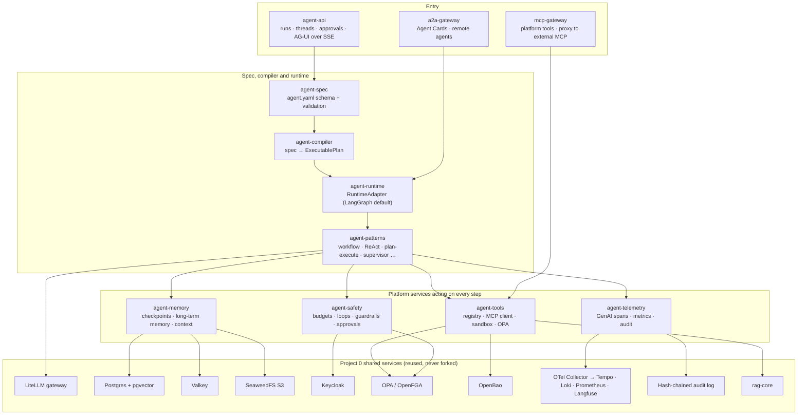
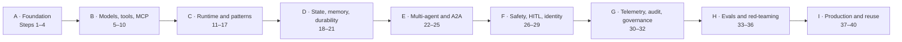
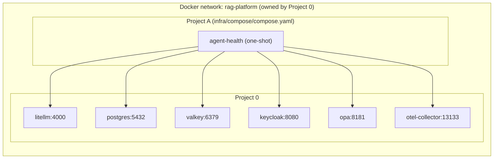

# Architecture

Project A turns an `agent.yaml` into a governed, running system on top of Project 0's shared
services. This page is the overview; detailed C4, data-flow and sequence diagrams are added as
the steps that build each part land.

## Layers (redrawn from the spec's architecture widget)

Requests enter through the API or a gateway; the compiler and runtime execute the spec; the
four platform services act on every step; everything runs on Project 0's shared services.

## Roadmap (redrawn from the spec's roadmap widget)

## How Project A connects to Project 0 (Step 1)

