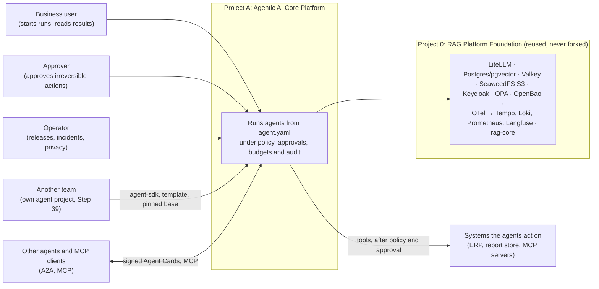
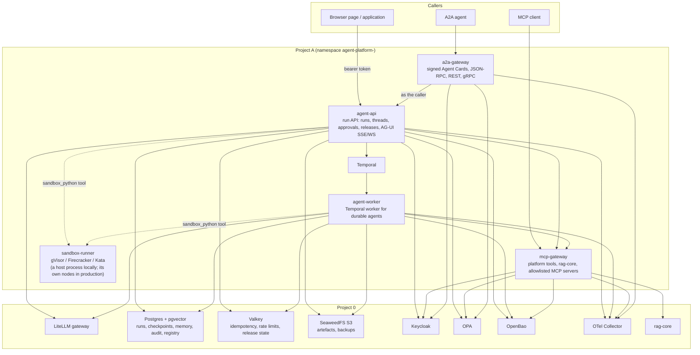
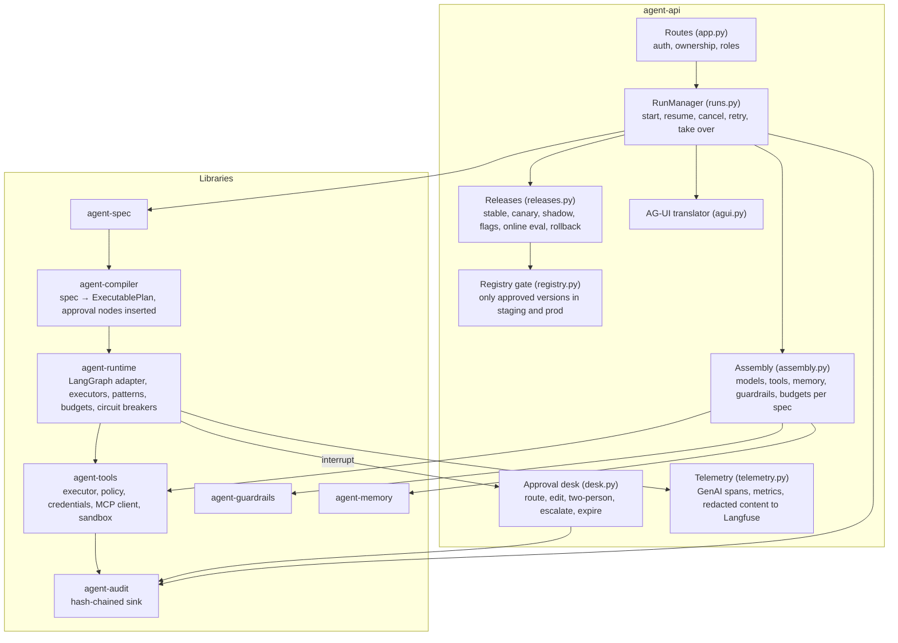
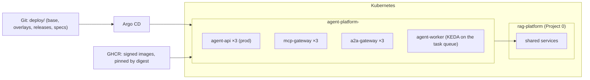

# C4 views

Three zoom levels: who uses the platform (context), what runs (containers), and what is inside
the run API (components). The deployment view shows how the containers sit in a cluster.

## 1. Context

## 2. Containers

- Every container verifies Keycloak tokens itself. Nothing trusts the network.
- Every tool call is decided by OPA (or Cerbos or OpenFGA, the documented alternatives) before
  it runs.
- Secrets come only from OpenBao, as short leases.
- Locally, every port binds to 127.0.0.1. In a cluster, a default-deny NetworkPolicy allows
  only the arrows above.

## 3. Components of the run API

## 4. Deployment

- **Changes:** every change goes through a pull request. `just promote` writes it; the promotion
  rules and eval gates check it; prod needs its named approver.
- **Images:** images are pinned by digest. The images workflow builds, signs and scans them.
- **Replicas:** dev, staging and prod differ only in replicas, resources and which agent
  versions serve.
- **Evidence:** deploy-e2e builds the same overlays on kind and checks them on every push
  ([results](../results.md)).
