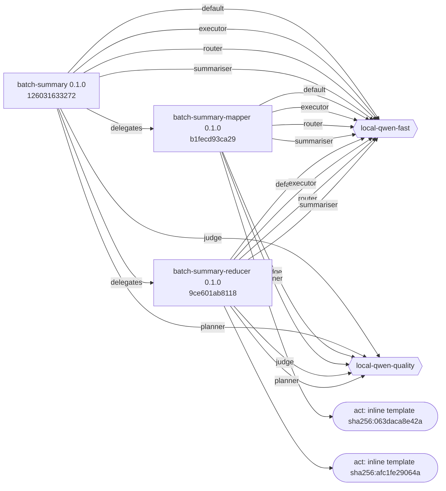
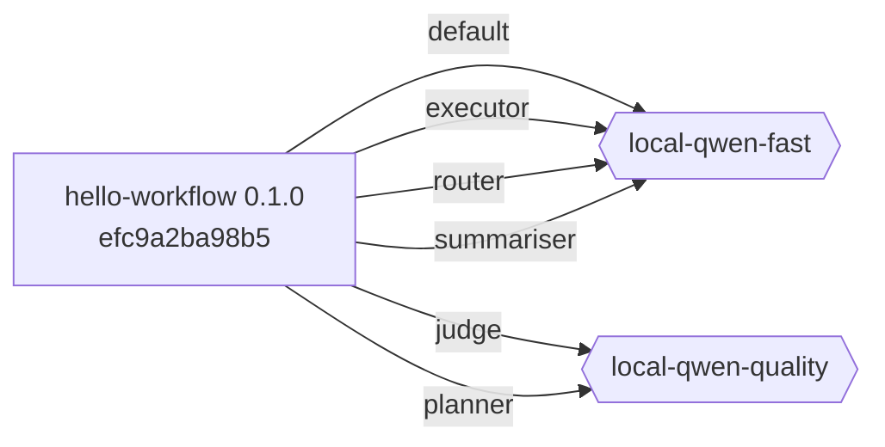
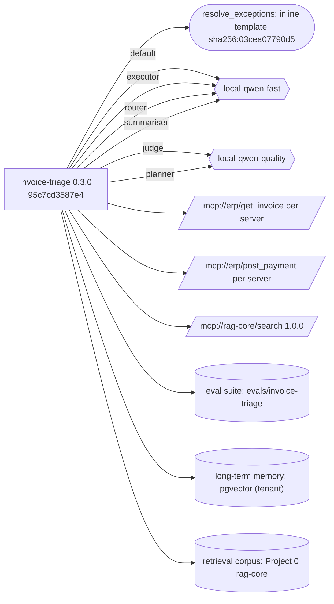
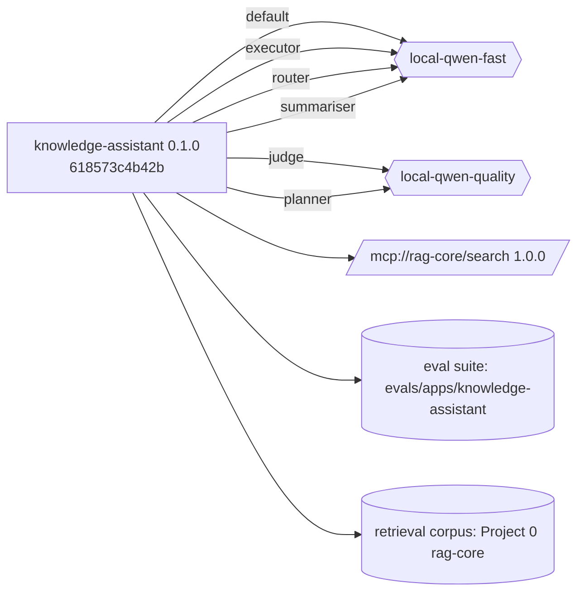
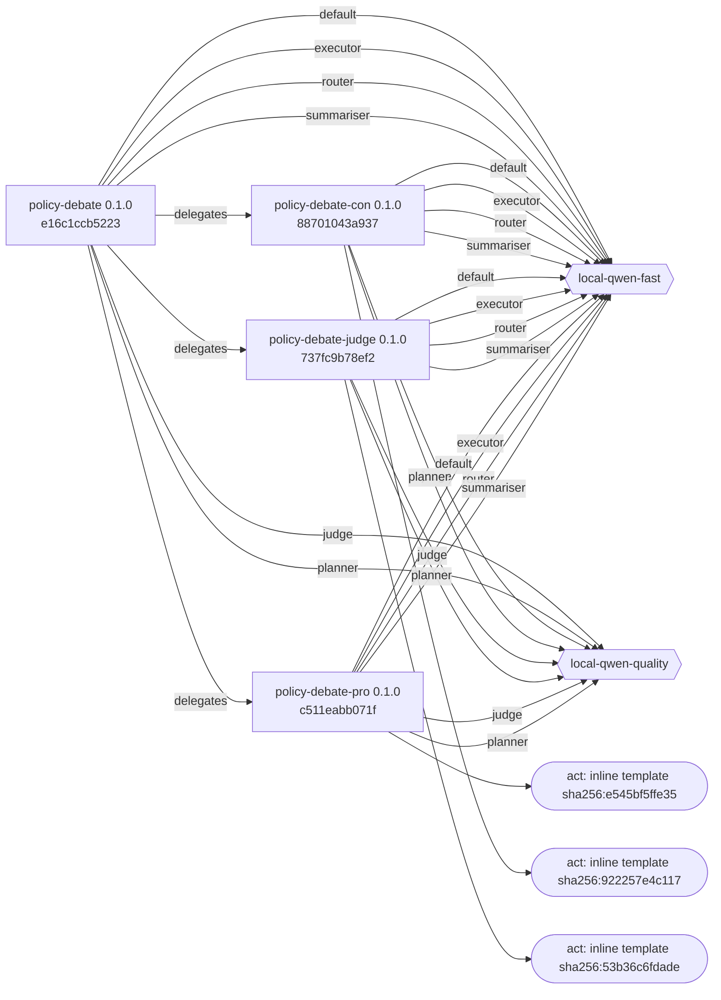
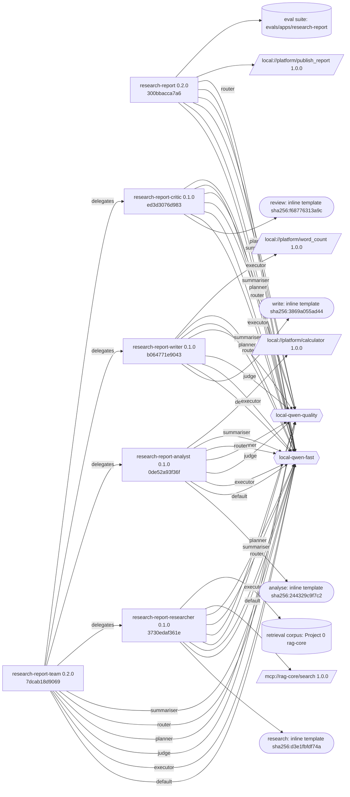
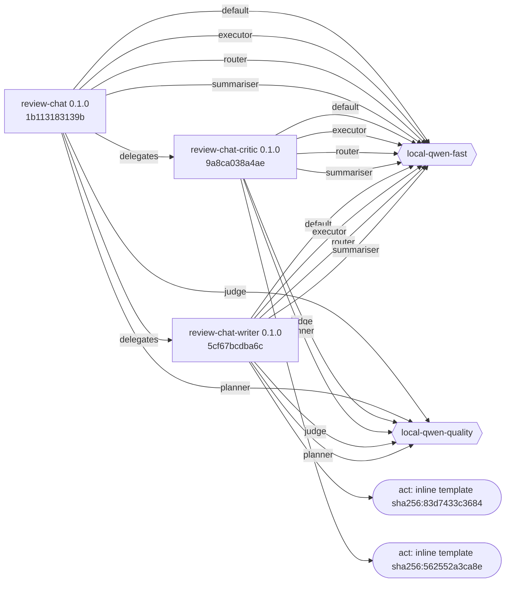
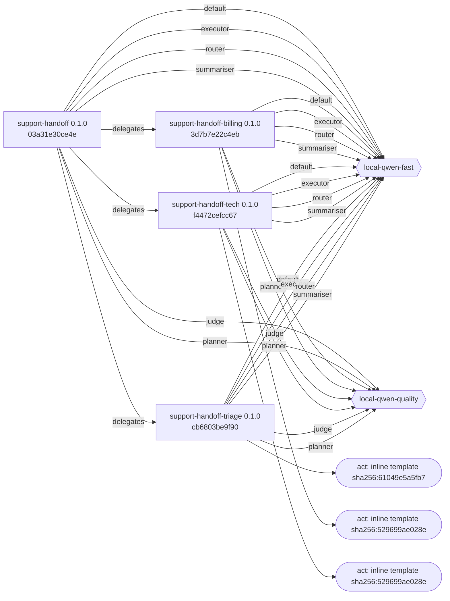

# Lineage

Generated by `just cards` from the specs and registries — do not edit by hand.

For each reference app: spec → prompts → models → tools → datasets, through its workers. Spec hashes are the `spec_hash` in every audit event's `versions` (Step 31).

## batch-summary

| Agent | Spec | Prompts | Models | Tools | Datasets |
|---|---|---|---|---|---|
| batch-summary | `agents/batch-summary/agent.yaml` 0.1.0 `126031633272` | - | local-qwen-fast, local-qwen-quality | - | - |
| batch-summary-mapper | `agents/batch-summary/workers/mapper.yaml` 0.1.0 `b1fecd93ca29` | act: inline template sha256:063daca8e42a | local-qwen-fast, local-qwen-quality | - | - |
| batch-summary-reducer | `agents/batch-summary/workers/reducer.yaml` 0.1.0 `9ce601ab8118` | act: inline template sha256:afc1fe29064a | local-qwen-fast, local-qwen-quality | - | - |

## hello-workflow

| Agent | Spec | Prompts | Models | Tools | Datasets |
|---|---|---|---|---|---|
| hello-workflow | `agents/hello-workflow/agent.yaml` 0.1.0 `efc9a2ba98b5` | - | local-qwen-fast, local-qwen-quality | - | - |

## invoice-triage

| Agent | Spec | Prompts | Models | Tools | Datasets |
|---|---|---|---|---|---|
| invoice-triage | `agents/invoice-triage/agent.yaml` 0.3.0 `95c7cd3587e4` | resolve_exceptions: inline template sha256:03cea07790d5 | local-qwen-fast, local-qwen-quality | `mcp://erp/get_invoice` per server `mcp://erp/post_payment` per server `mcp://rag-core/search` 1.0.0 | eval suite: evals/invoice-triage (not in the repository yet) long-term memory: pgvector (tenant) (runtime data) retrieval corpus: Project 0 rag-core (runtime data) |

## knowledge-assistant

| Agent | Spec | Prompts | Models | Tools | Datasets |
|---|---|---|---|---|---|
| knowledge-assistant | `agents/knowledge-assistant/agent.yaml` 0.1.0 `618573c4b42b` | - | local-qwen-fast, local-qwen-quality | `mcp://rag-core/search` 1.0.0 | eval suite: evals/apps/knowledge-assistant retrieval corpus: Project 0 rag-core (runtime data) |

## policy-debate

| Agent | Spec | Prompts | Models | Tools | Datasets |
|---|---|---|---|---|---|
| policy-debate | `agents/policy-debate/agent.yaml` 0.1.0 `e16c1ccb5223` | - | local-qwen-fast, local-qwen-quality | - | - |
| policy-debate-con | `agents/policy-debate/workers/con.yaml` 0.1.0 `88701043a937` | act: inline template sha256:922257e4c117 | local-qwen-fast, local-qwen-quality | - | - |
| policy-debate-judge | `agents/policy-debate/workers/judge.yaml` 0.1.0 `737fc9b78ef2` | act: inline template sha256:53b36c6fdade | local-qwen-fast, local-qwen-quality | - | - |
| policy-debate-pro | `agents/policy-debate/workers/pro.yaml` 0.1.0 `c511eabb071f` | act: inline template sha256:e545bf5ffe35 | local-qwen-fast, local-qwen-quality | - | - |

## research-report

| Agent | Spec | Prompts | Models | Tools | Datasets |
|---|---|---|---|---|---|
| research-report | `agents/research-report/agent.yaml` 0.2.0 `300bbacca7a6` | - | local-qwen-fast, local-qwen-quality | `local://platform/publish_report` 1.0.0 | eval suite: evals/apps/research-report |
| research-report-analyst | `agents/research-report/workers/analyst.yaml` 0.1.0 `0de52a93f36f` | analyse: inline template sha256:244329c9f7c2 | local-qwen-fast, local-qwen-quality | `local://platform/calculator` 1.0.0 | - |
| research-report-critic | `agents/research-report/workers/critic.yaml` 0.1.0 `ed3d3076d983` | review: inline template sha256:f68776313a9c | local-qwen-fast, local-qwen-quality | - | - |
| research-report-researcher | `agents/research-report/workers/researcher.yaml` 0.1.0 `3730edaf361e` | research: inline template sha256:d3e1fbfdf74a | local-qwen-fast, local-qwen-quality | `mcp://rag-core/search` 1.0.0 | retrieval corpus: Project 0 rag-core (runtime data) |
| research-report-team | `agents/research-report/workers/team.yaml` 0.2.0 `7dcab18d9069` | - | local-qwen-fast, local-qwen-quality | - | - |
| research-report-writer | `agents/research-report/workers/writer.yaml` 0.1.0 `b064771e9043` | write: inline template sha256:3869a055ad44 | local-qwen-fast, local-qwen-quality | `local://platform/word_count` 1.0.0 | - |

## review-chat

| Agent | Spec | Prompts | Models | Tools | Datasets |
|---|---|---|---|---|---|
| review-chat | `agents/review-chat/agent.yaml` 0.1.0 `1b113183139b` | - | local-qwen-fast, local-qwen-quality | - | - |
| review-chat-critic | `agents/review-chat/workers/critic.yaml` 0.1.0 `9a8ca038a4ae` | act: inline template sha256:562552a3ca8e | local-qwen-fast, local-qwen-quality | - | - |
| review-chat-writer | `agents/review-chat/workers/writer.yaml` 0.1.0 `5cf67bcdba6c` | act: inline template sha256:83d7433c3684 | local-qwen-fast, local-qwen-quality | - | - |

## support-handoff

| Agent | Spec | Prompts | Models | Tools | Datasets |
|---|---|---|---|---|---|
| support-handoff | `agents/support-handoff/agent.yaml` 0.1.0 `03a31e30ce4e` | - | local-qwen-fast, local-qwen-quality | - | - |
| support-handoff-billing | `agents/support-handoff/workers/billing.yaml` 0.1.0 `3d7b7e22c4eb` | act: inline template sha256:529699ae028e | local-qwen-fast, local-qwen-quality | - | - |
| support-handoff-tech | `agents/support-handoff/workers/tech.yaml` 0.1.0 `f4472cefcc67` | act: inline template sha256:529699ae028e | local-qwen-fast, local-qwen-quality | - | - |
| support-handoff-triage | `agents/support-handoff/workers/triage.yaml` 0.1.0 `cb6803be9f90` | act: inline template sha256:61049e5a5fb7 | local-qwen-fast, local-qwen-quality | - | - |
