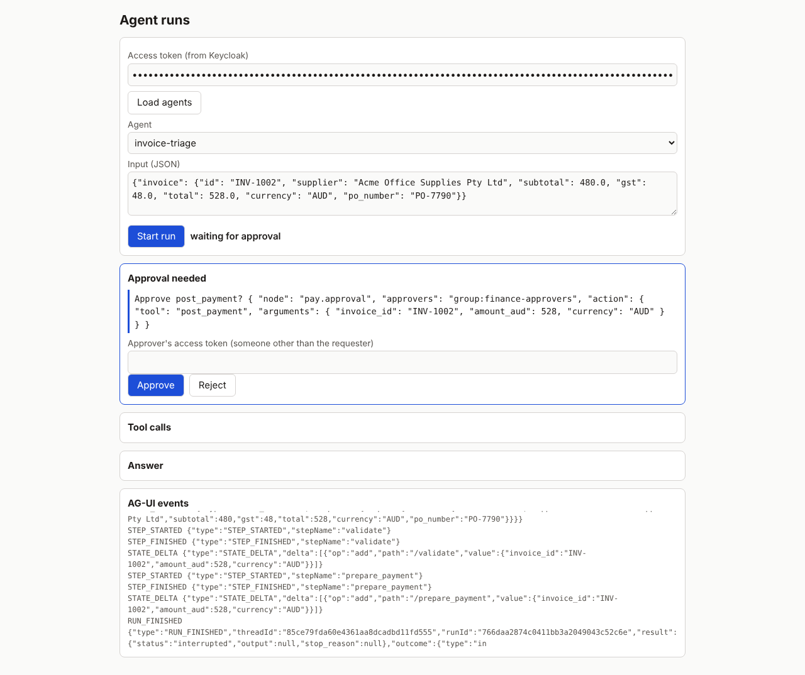
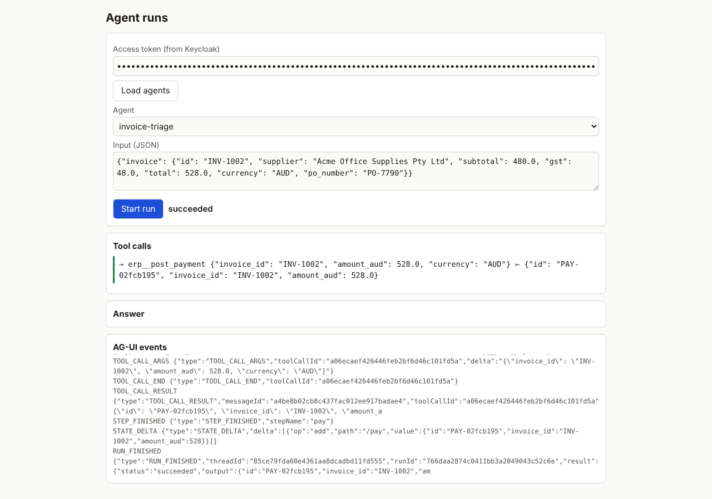

# Step 17 · Run API and streaming

## 1. At a glance

| | |
|---|---|
| **Goal** | A web API through which apps and people start agents, watch them work live, approve risky actions and stop them |
| **Time** | About two days |
| **You end up with** | `agent-api` (port 8091): runs, AG-UI events over SSE or WebSocket, approvals from verified tokens, idempotent creation, cancel, threads; a minimal page at `/` |
| **New words** | API, AG-UI, SSE, WebSocket, interrupt, idempotency key |

## 2. The big idea

Until now, agents ran from code and tests. People need a front door: start a run, see what the
agent is doing as it happens, and say yes or no when it wants to do something irreversible.
Step 17 builds that door, speaking AG-UI, an open protocol that agent user interfaces already
understand.

> *Analogy:* a delivery tracker. You place the order (create a run), watch it move (live events),
> sign for the parcel when it arrives (approve), or cancel it. The tracker knows your signature
> is yours because you are logged in, not because you typed a name.

## 3. What we're doing

1. Collect events from inside every run: steps, tool calls, streamed text, state changes.
2. Translate them to AG-UI and stream them over SSE (or a WebSocket).
3. Build the run endpoints: create, state, events, approvals, resume, cancel, threads.
4. Make approvals come from the approver's verified login.
5. Ship a minimal page that drives all of this using only AG-UI events.

## 4. Why we're doing this

Watching an agent work builds trust and catches problems early; approving from a screen is how
people stay in control of irreversible actions. Using a standard event protocol means any
AG-UI-compatible interface can sit on top, not just our page.

> *Watch out:* an approval is only as trustworthy as the identity behind it. The API takes the
> approver from their token; whatever the request body says about "who" is ignored.

## 5. Key ideas

- **Events from inside the run.** Each step, tool call and piece of model text is reported as it
  happens, on both runtimes and after resuming from an approval.
- **AG-UI.** Standard events: `RUN_STARTED`, `STEP_STARTED/FINISHED`, `TEXT_MESSAGE_*`,
  `TOOL_CALL_START/ARGS/END/RESULT`, `STATE_DELTA`, `RUN_FINISHED`, `RUN_ERROR`.
- **Interrupts.** When a person must approve, the run finishes its current segment with an
  `interrupt` outcome that names the action, its arguments and who may approve.
- **SSE or WebSocket.** The same numbered events either way; reconnect with `after=<number>`.
- **Tokens never in URLs.** The page reads SSE with `fetch` so the token stays in a header; the
  WebSocket gets it in the first message.
- **Idempotency key.** Sending the same create request twice with the same key gives the same
  run, so a retry after a network blip never starts a second payment run.
- **Ownership.** Runs are visible only to their owner and to approvers of their pending approval
  in the same tenant.

## 6. How to do it

Start the service (with the rest of the stack):

```bash
just up            # mcp-gateway and agent-api, ports on 127.0.0.1
open http://127.0.0.1:8091/
```

Create a run and follow its events from the command line:

```bash
TOKEN=...   # an access token from Keycloak
curl -s -X POST http://127.0.0.1:8091/v1/agents/invoice-triage/runs \
  -H "Authorization: Bearer $TOKEN" -H "Idempotency-Key: $(uuidgen)" \
  -H "Content-Type: application/json" -d '{"input": {"invoice": {...}}}'
curl -N http://127.0.0.1:8091/v1/runs/<run_id>/events -H "Authorization: Bearer $TOKEN"
```

Approve as someone in the approver group:

```bash
curl -s -X POST http://127.0.0.1:8091/v1/runs/<run_id>/approvals \
  -H "Authorization: Bearer $APPROVER_TOKEN" -H "Content-Type: application/json" \
  -d '{"approved": true}'
```

The page, waiting for an approval and after it:





## 7. Benefits

- Any AG-UI client can show our agents' work live.
- People approve exactly the action shown, as themselves.
- Safe retries through idempotency keys; clean cancellation.
- One code path for both runtimes, through pauses and resumes.

## 8. Drawbacks and risks

- Runs live in memory until Step 18: restarting the service loses them.
- After a long wait, the run continues with the requester's token, which may have expired
  (delegated credentials are Step 29).
- One approver per decision for now; two-person approval, edits, SLAs and expiry are Step 28.
- Events include tool arguments and results; redaction of personal data comes with guardrails
  (Step 27).

## 9. Alternatives

| Choice | Alternative | When the alternative wins |
|---|---|---|
| SSE | WebSocket (`/v1/runs/{id}/ws`) | Clients that already hold a socket, or need to send messages back on the same connection |
| AG-UI events | Custom JSON | Never for new UIs; only for a legacy client that cannot change |
| Our minimal page | An AG-UI client library (e.g. CopilotKit) | Product UIs; the API is the same |

## 10. Which approach fits which situation

- **A web app showing an agent's progress:** SSE with `fetch`, reconnecting with `after`.
- **A back-end service starting runs:** create with an idempotency key, then poll state or follow
  events.
- **An approvals inbox:** list runs waiting on your group (the interrupt names it), then post a
  decision as yourself.
- **Long human waits:** fine for now, but keep the run's service up until Step 18 makes runs
  durable.

## 11. Common mistakes

- Putting the token in the events URL so `EventSource` can use it: it ends up in logs.
- Retrying a create without an idempotency key: two runs, possibly two payments queued.
- Having the requester approve their own run: refused, by the API and by policy.
- Answering an approval through `/resume`: refused; approvals go through `/approvals`.

## 12. Done when

| Check | Status | Evidence (this build) |
|---|---|---|
| Create, stream, state, cancel, resume, threads, submit approval | ✅ | 9 API tests: each endpoint; resume refuses approval interrupts; cancel ends with a `cancelled` outcome; threads per user |
| AG-UI events over SSE (text deltas, tool calls, state deltas, approval requests) | ✅ | the stream contains every listed event type in order with continuous ids; text streams token by token; the approval is an AG-UI `interrupt` naming the action and arguments |
| Idempotent run creation | ✅ | same key and body → same run (200); same key, different body → 409 |
| WebSocket alternative | ✅ | the same events over `/ws` with the token in the first message; another tenant is refused |
| Approver from a verified token | ✅ | self-approval 403; outsider 404; a body `by` field is ignored and the audit names the token's user; integration test with real Keycloak tokens and OPA |
| A minimal web page shows live tool calls and an approval button using only AG-UI events | ✅ | headless Chromium drives the page against the real service: start, approval card, approve as a second user, payment tool call and result shown, status `succeeded` (screenshots above) |
| ADR | ✅ | ADR 0028 |

## 13. Recap

Step 17 gave the platform its front door. A run can be started safely (idempotent), watched live
in a standard protocol (AG-UI over SSE or WebSocket) with text, tool calls and state as they
happen, paused for an approval that only a verified approver, not the requester, can give, and
cancelled. A minimal page proves it end to end in a real browser against the real service.
