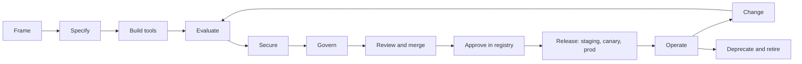

# The full lifecycle of an agent

From an idea to retirement. Each stage names what you produce, the command or check, and the
gate that has to pass before the next stage. [local-to-prod.md](local-to-prod.md) walks the
deployment part in order.

## 1. Frame the job

- **What:** the outcome, the people it serves, what it may change in the world, and what must
  never happen.
- **Decide:** the autonomy level (`workflow`, `agent`, `multi_agent`, `hybrid`) and the pattern.
  Use the least autonomy that does the job ([when-to-choose.md](when-to-choose.md)).
- **Decide:** the risk tier (`low`, `medium`, `high`). It sets the reviewers (CODEOWNERS), the
  eval gates' limits, and how many stable runs the online evaluation scores (all of them for
  high).

## 2. Specify

- **What:** `agents/<name>/agent.yaml`:
  - the pattern and nodes;
  - the models by role;
  - the tools, by exact ref (`mcp://`, `local://`, `a2a://`, `sandbox://`);
  - mandatory budgets;
  - guardrails;
  - memory;
  - the owner;
  - its eval suite.
- **Check:** `just validate`, which gives readable errors with line numbers, and
  `just compile`. The compiler inserts an approval in front of every irreversible tool.
- **Gate:** the schema, and the compiler's checks.

## 3. Build or connect the tools

- **What:** an MCP server's tools, or a local tool with a `ToolSpec`: its input and output
  schema, its side effect (`read`, `write`, `irreversible`), whether it is idempotent, and its
  timeout ([how-to/add-a-tool.md](../how-to/add-a-tool.md)).
- **Check:** contract tests. A new MCP server goes on the allowlist, and its tool descriptions
  are screened for injections.
- **Gate:** an honest side effect. Anything that sends, pays or deletes is `irreversible`.

## 4. Evaluate

- **What:**
  - at least 100 golden tasks (generated, plus hand-written edge cases);
  - deterministic checks over the run's records;
  - a rubric for a judge only where no check can decide.
- **Check:**
  - `just eval-app <name>`: mechanics, on the stand-in;
  - `--provider gateway --publish`: the real-model baseline (VERIFY-ON-MAC);
  - `just eval-baseline`.
- **Gate:** a recorded baseline. The eval gates compare every later change with it.

## 5. Secure

- **What:**
  - the red-team suite (ASI01 to ASI10) and the attack libraries;
  - the agent's entries in the threat model, if it adds a component or a trust boundary.
- **Check:** `just redteam`, `just threat-check`.
- **Gate:** no high or critical finding. Every ASI category has an executed test.

## 6. Govern

- **What:**
  - the agent card and system card (generated from the spec);
  - lineage;
  - the AI-use register entry;
  - CODEOWNERS for its risk tier.
- **Check:** `just cards`, `just cards-check`.
- **Gate:** the cards are current, and the owner is named.

## 7. Review and merge

- **What:** the pull request.
- **Check:** CI runs:
  - lint, types, unit, contract, replay and Rego tests;
  - deployment and promotion rules;
  - the eval gates for the touched agents (results posted on the pull request);
  - the red team.

  A cost or token increase above the tier's limit needs `/approve-cost` in a review. High risk
  needs `/eval-signoff`.
- **Gate:** green CI and the code owners' review. After the merge, dev runs it.

## 8. Approve in the registry

- **What:** `just agents --approve <name> <version> --by <you> --reason "..." [--expires ...]`.
- **Gate:** in staging and prod, only approved versions run or can be delegated to. An approval
  can expire.

## 9. Release

1. `just promote <name> --to staging`.
2. `just promote <name> --to prod`: the first release goes in as stable; later ones as a 10%
   canary or a shadow.
3. The online evaluation passes, then `just promote <name> --to prod --full`.

Each step is a pull request. Prod needs its named approver. A breach rolls the canary back
automatically.

## 10. Operate

- **What you watch:**
  - SLOs and alerts, each with a runbook ([runbooks](../runbooks/README.md));
  - the approval inbox and the review-after samples;
  - cost against the tenant's budget.
- **Where:** traces in Tempo (no content), redacted content in Langfuse, and the hash-chained
  audit trail (`just audit-verify`, `just audit-replay <run_id>`).
- **When something goes wrong:**
  - the [kill switch](../runbooks/kill-switch.md): agent, tool or tenant;
  - feature flags;
  - cancel or take over a run.
- **Recovery:** `just dr-drill` rehearses a restore against the stated RPO and RTO.

## 11. Change

- **Any change is a new version:** spec, prompt, tool or model. Every run and audit event
  records all four.
- **The cycle repeats from stage 4:** evaluate against the baseline, then gate, review,
  approve and release.
- **Runs in flight** finish on the version they started with.

## 12. Data

- **People's own data:** a person can export it (`GET /v1/me/export`) and delete their memories.
- **Erasure:** a privacy officer can erase a user everywhere (`POST /v1/admin/erasure`).
- **Retention:** applied on a schedule, and it never prunes a run that is waiting for a person.

## 13. Deprecate and retire

- `just agents --deprecate <name> <version> --by <you> --reason "replaced by ..."`. Runs already
  in progress continue. A deprecated version can be approved again or retired. Retired is final.
  Stopping a version at once is the [kill switch](../runbooks/kill-switch.md).
- Retiring it removes it from serving: take it out of the releases files by pull request.
- Its snapshots under `deploy/specs/`, its audit trail and its cards stay for the retention
  period, so its past runs can still be explained.
