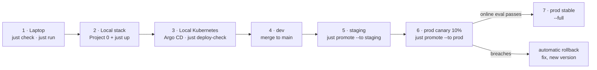

# From your laptop to production

One path, end to end: write an agent on the Mac, run it against Project 0, then promote it
through dev, staging, a prod canary and prod. Detailed setup is in
[setup/local.md](../setup/local.md) and [setup/production.md](../setup/production.md). The
decisions behind it are in ADR 0049 (environments and promotion) and ADR 0050 (projects).



## 1. On the laptop: the inner loop

No services are needed. The stand-in models answer with canned responses, so this checks
mechanics, not quality.

```bash
just sync                              # install the workspace (uv, pinned lock)
just validate agents/my-agent          # readable errors, with line numbers
just compile agents/my-agent/agent.yaml
just run agents/my-agent/agent.yaml '{"task": "..."}'
just test                              # unit, contract and replay tests, offline
just check                             # everything CI's first job runs
```

A team outside this repository does the same from its own project:
`agentctl validate / run / eval` (Step 39).

## 2. Against Project 0 on the Mac (VERIFY-ON-MAC)

Project 0 provides the gateway, Postgres, Valkey, S3, Keycloak, OPA, OpenBao, observability and
`rag-core`.

```bash
just health                            # Project 0's services answer
just provision                         # this platform's databases, clients, keys (idempotent)
just migrate
just up                                # agent-api, mcp-gateway, a2a-gateway on 127.0.0.1
just test-integration
just eval-app my-agent --provider gateway --publish   # real models: the quality baseline
just redteam                           # ASI01 to ASI10 against the live policy
```

Record the real-model baseline here. It is the first number that says anything about quality,
and the gates use it from then on.

## 3. Local Kubernetes (OrbStack on the Mac)

```bash
just cluster-addons                    # then Argo CD and KEDA (setup/production.md §1)
just deploy-check                      # render dev, staging and prod; schemas; deploy policy
```

The same check runs in CI on a kind cluster (`deploy-e2e`): Argo CD syncs dev, every overlay is
admitted by the API server, OpenBao Kubernetes auth works, and a run goes through `agent-api`.

## 4. dev: merge to main

- **What a pull request runs:**
  - the CI jobs (lint, types, unit, contract, replay and Rego tests);
  - the deployment and promotion checks;
  - the eval gates for the agents it touches;
  - the red team.
- **Who reviews:** the people CODEOWNERS names for the agent's risk tier.
- **Images:** the `images` workflow builds, scans, signs and publishes them by digest.
- **After merge:** Argo CD syncs dev, and dev runs `agents/` at main's head.
- **Moving an environment to new platform code** is its own pull request:
  `just deploy-images <env> <commit>`.

## 5. staging

```bash
just promote my-agent --to staging --commit
```

- The pull request snapshots the version into `deploy/specs/my-agent/<version>/` (immutable)
  and makes staging serve it.
- The nightly and release workflows run the full eval and red-team suites.
- In staging and prod, only versions the registry has **approved** run
  (`just agents --approve my-agent <version> --by <you> --reason "..."`).

## 6. A canary in prod

```bash
just promote my-agent --to prod --commit            # 10% of new threads (or --shadow)
```

- A first release goes in as stable straight away. Later versions go in as a canary.
- The named prod approver reviews the pull request.
- **Sticky threads:** a thread stays on the version its first run was given.
- **Watching it:** `GET /v1/admin/releases` shows the online evaluation. Each candidate run is
  scored against the stable version on failures, cost and time, once the gate's minimum number
  of runs is reached.

## 7. Prod stable, or rollback

- **The canary passes:**
  `just promote my-agent --to prod --full --api <prod run API> --commit`. It refuses unless the
  live verdict is `pass`. Its pull request makes the canary stable.
- **The canary breaches:** it is rolled back at once on every replica, and
  `AgentReleaseRolledBack` fires ([runbook](../runbooks/release-rollback.md)).
  1. Run `just promote my-agent --abort` so Git matches what serves.
  2. Fix the agent.
  3. Release it as a new version. A version that was rolled back never serves again.
- **A whole environment goes wrong:** revert the merge, and Argo CD syncs back. Images and specs
  are immutable, so a revert restores exactly what ran.

## What changes between environments, and what doesn't

| | dev | staging | prod |
|---|---|---|---|
| Follows | `agents/` at main's head | `deploy/releases/staging.yaml` | `deploy/releases/prod.yaml` |
| Changed by | a merge | a promotion pull request | a promotion pull request with the named approver |
| Replicas (API, MCP, A2A) | 1 | 2 | 3 |
| Workers | 1 | KEDA 1–4 | KEDA 2–10 |

The same in every environment:
- the images, by digest;
- the policies;
- Pod Security `restricted` and deny-by-default networking;
- secrets only from OpenBao, through the environment's own mount and role.
