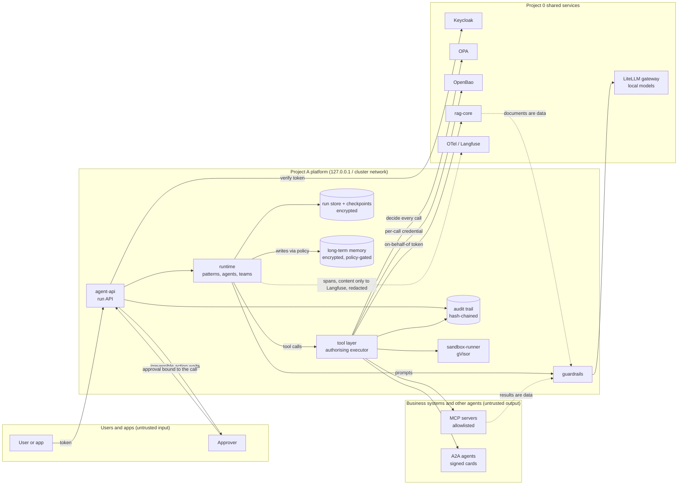

# Data flows and trust boundaries

What crosses which boundary, so each threat in the [threat model](threat-model.md) has a place.
Dashed boxes are trust boundaries: anything crossing one is checked on arrival (identity, policy)
and, if it is content, treated as data, never as instructions.

## 1. A run, end to end

## 2. Data by kind

| Data | Created by | Stored where | Protection | Leaves the platform to | Lifetime |
|---|---|---|---|---|---|
| Run input and output, event log (transcript) | agent-api | run store (Postgres) | encrypted per run and event; tenant and user columns only in clear | the owner's export; Langfuse (redacted content) | 90 days after the run ends ([data lifecycle](../../governance/data-lifecycle.yaml)) |
| Checkpoints | runtime | Postgres | encrypted, bound to tenant, thread and checkpoint | nowhere | 30 days, newest per thread kept |
| Long-term memory | runtime via memory policy | pgvector / Qdrant / Mem0 | encrypted, provenance, PII redacted, untrusted refused | the owner's export | per kind (memory policy) |
| Tool arguments and results | tool layer | audit (digest + redacted copy) | redaction; results are untrusted data | the tool's own system | audit: about 7 years |
| Credentials | OpenBao | never stored by the platform | per call, 5-minute leases, revoked after | the one tool call | minutes |
| Approvals | approval desk | approval store, audit | bound to the exact call; approver from a verified token | approvers' inbox | with the run |
| Traces and metrics | telemetry | Project 0 (Tempo, Prometheus, Langfuse) | content only in Langfuse, redacted; withheld if redaction fails | Project 0 | Project 0's settings |

## 3. Where a person's data can be reached

- **Access:** `GET /v1/me/export` (own data), `POST /v1/admin/export` (privacy officer).
- **Erasure:** `POST /v1/admin/erasure` removes runs, transcripts, checkpoint threads and every
  agent's memories about the person. The audit trail keeps only digests and redacted arguments,
  and records the erasure itself.
- **Correction:** memories are deleted and re-stated by the person; runs are records of what
  happened and are not edited.
- **Retention:** `POST /v1/admin/retention` applies the policy (scheduled with the deployment,
  Step 38).
